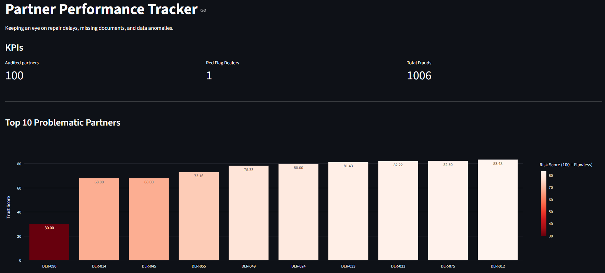
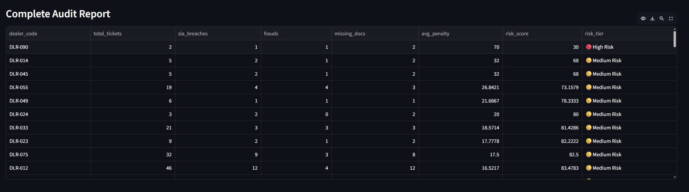
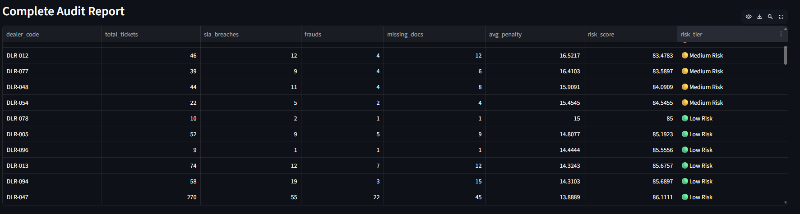

### Partner-Performance-Tracker

This is my second project in the financial space after the <B>Supplier Pricing Tool</B> project. This one has been built on and off over about 2 weeks during my 4th year at UPB. After my previous project, I kept brainstorming for new ideas and this time, compliance and data auditing caught my attention.

Whenever a large company works with hundreds of external partners, they constantly receive operational logs, like service interventions / replacements, etc. The issue? These datasets are massive, can be incredibly messy and often hide expensive compliance breaches. If a dealer holds a loaner vehicle for 30 days instead of the allowed 5 (an SLA breach), or submits incomplete paperwork, the main company loses money and resources.

Auditing tens of thousands of these records manually in Excel is a nightmare and highly prone to human error. Building something automated help up catch bad actors and saving days of manual work.

So, how does this Python project work? It ingests raw, messy data from a database, just like the first project, cleans it up and runs it through a custom scoring algorithm to automatically evaluate the trustworthiness of every single partner.

### The logic behind it

To make sure the business immediately knows which partners are causing trouble, the script evaluates everyone using a custom <B>Weighter Risk Matrix</B>.

Every partner starts with a flawless Trust Score of 100. This script calculates the real duration of every service ticket and deducts points based on the severity of the errors:

* Missing Documentation: -10 points
* SLA Breach (keeping an asset > 5 days): -20 points
* Choronological Fraud (end date is before start date): -100 points (Instant Red Flag)

It aggregates these penalties across all tickets, calculates the average per partner and categorizes them into low medium or high-risk tiers.

### Project MVPs

I didn't like the idea of just having a terminal script that outputs a CSV swo the main highliths of this project are:

* The underlying data of 20.000 logs isn't just randomly generated, it uses a numpy pareto distribution (80/20 rule) to simulate the reality of 20% of the partners cause 80% of the problems;
* Automatically handles missing dealer IDs, standardizes broken datatime formats and preps the messy logs for analysis;
* Used Pandas to instantly calculate penalties across thousands of rows;
* A clean web interface where we can instantly see the total number of frauds, overall risk tiers and everything detailed;

### Built With
-> Python (Pandas & NumPy for data cleaning and math)  
-> SQLite3 (database management)  
-> Streamlit (web interface)  
-> Plotly (interactive charts)

### A quick glimpse at how the interface looks like

Here is the top section. It instantly displays the KPIs alongside a dynamic bar chart highlighting the **Top 10 Problematic Partners**. The darker the red, the worse their trust score is.

Further down, we can also see the **Complete Audit Report**. This interactive table breaks down exactly *why* a partner was penalized. In this first look, we can clearly see one problematic partner that was grouped into the **High Risk** and multiple ones grouped in **Medium Risk** based on their specific SLA breaches and missing documents.

And finally, if we scroll down inside the report table, we go from **High Risk** and **Medium Risk** individuals to **Low Risk** partners who are actually following the rules and maintaining a flawless score.

